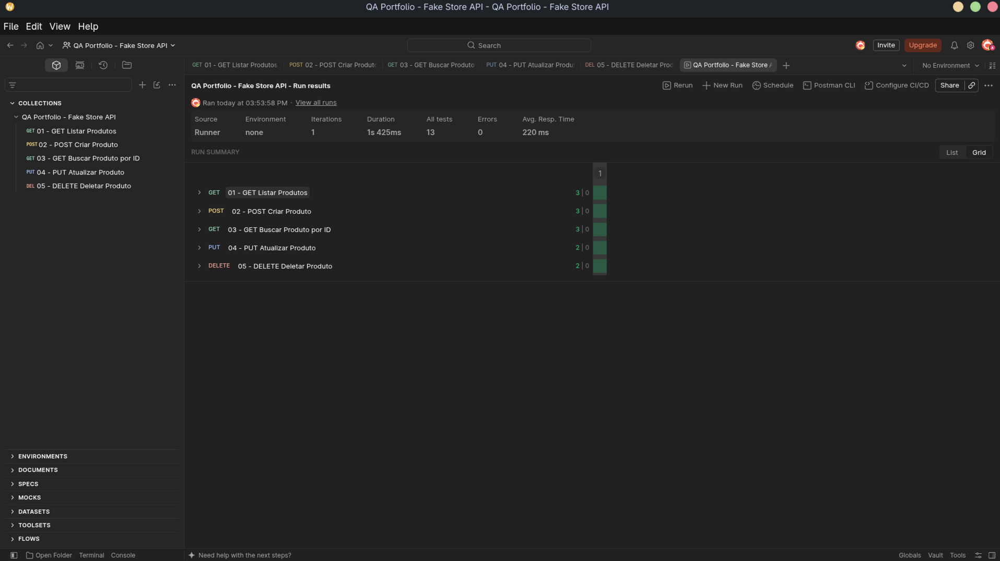

# 🚀 QA API Testing Portfolio - Fake Store API

Repositório com a suíte de testes automatizados de API desenvolvida durante meus estudos e práticas em Quality Assurance.

## 👤 Sobre

**QA Engineer em Formação:** Leandro Abdallah

**LinkedIn:** [leandroabdallah](https://www.linkedin.com/in/leandroabdallah)

**GitHub:** [abdallahleandro](https://github.com/abdallahleandro)

Sou um profissional em transição de carreira para **Quality Assurance**, com forte background em Suporte Técnico e contribuições Open Source no **Fedora Project**. 

Este projeto tem como objetivo aplicar conceitos de **API Testing**, **Automação de Testes** e **Documentação Técnica**, simulando o fluxo de trabalho de um QA em um ambiente ágil. Utilizo a **Fake Store API** (uma API REST pública) para validar contratos, regras de negócio e o ciclo completo de CRUD (Create, Read, Update, Delete).

Acredito que a qualidade de software vai além de achar bugs: trata-se de **prevenir falhas**, **garantir a experiência do usuário** e **documentar evidências** que ajudem o time a tomar decisões melhores.

---

## 🧪 Resumo dos Testes (Test Suite)

A suíte cobre os 5 endpoints principais da API, com **13 asserções automatizadas** em JavaScript (Chai.js) executadas via Postman Collection Runner.

| ID | Endpoint | Método | Cenário de Teste | Resultado Esperado | Status |
| :--- | :--- | :--- | :--- | :--- | :--- |
| **TC-001** | `/products` | GET | Listar todos os produtos | Status 200, array não vazio e schema válido. | ✅ Passou |
| **TC-002** | `/products` | POST | Criar um novo produto | Status 201, ID gerado e título correspondente. | ✅ Passou |
| **TC-003** | `/products/1` | GET | Buscar produto por ID | Status 200 e ID corresponde ao solicitado. | ✅ Passou |
| **TC-004** | `/products/1` | PUT | Atualizar um produto | Status 200 e título atualizado. | ✅ Passou |
| **TC-005** | `/products/1` | DELETE | Deletar um produto | Status 200 e objeto deletado retornado. | ✅ Passou |

## 📊 Métricas de Execução (Collection Runner)

| Métrica | Resultado |
| :--- | :--- |
| **Requisições Executadas** | 5 |
| **Total de Asserções** | 13 |
| **Falhas (Failures)** | 0 |
| **Erros (Errors)** | 0 |
| **Tempo Médio de Resposta** | ~223 ms |
| **Status Geral** | 🟢 **Aprovado (PASS)** |

### 📸 Evidência de Execução

---

## 📂 Estrutura do Repositório

- `FakeStoreAPI-QA-Portfolio.postman_collection.json`: Arquivo da Collection do Postman pronto para importar.
- `evidences/`: Pasta com os prints de tela (evidências) da execução verde no Postman.

## 🚀 Como executar este projeto

1. Faça o download do arquivo `.json` presente neste repositório.
2. Abra o **Postman** no seu computador.
3. Clique no botão **Import** (canto superior esquerdo) e selecione o arquivo baixado.
4. A Collection "QA Portfolio - Fake Store API" aparecerá no seu menu esquerdo.
5. Você pode executar requisição por requisição ou clicar nos três pontinhos da Collection e selecionar **"Run collection"** para executar toda a suíte via Collection Runner.

## 🔗 Links

- [Fake Store API - Documentação](https://fakestoreapi.com/docs)
- [Postman Learning Center](https://learning.postman.com/)
- [Meu projeto de QA no Fedora Project](https://github.com/abdallahleandro/QA-Fedora-Project)
